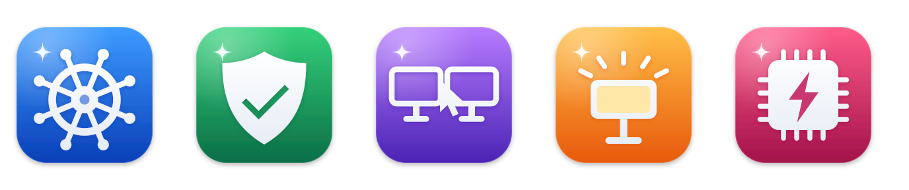

# Nova app icons

One family for every Nova app: the same tile, light wash and Nova sparkle, with a colour and glyph per app. Each
glyph matches the app's menu bar symbol.

| App         | Colour | Glyph         |
| ----------- | ------ | ------------- |
| NovaHelm    | blue   | ship's wheel  |
| NovaGuard   | green  | shield, check |
| NovaLink    | purple | two screens   |
| NovaGear    | amber  | key light     |
| NovaCompute | pink   | chip          |

## Crops

- `<app>.svg`: the macOS icon grid (824 px tile with a shadow on a 1024 px canvas), for the Mac `.icns`.
- `<app>-tile.svg`: the rounded tile alone, for favicons, the novahelm.dev logo, Windows `.ico` and the Linux icon.
- `<app>-square.svg`: full bleed with square corners, for home-screen and manifest icons (the OS rounds them).

## Where they go

| Surface                    | File                                                                               | Used by                                                           |
| -------------------------- | ---------------------------------------------------------------------------------- | ----------------------------------------------------------------- |
| Mac app bundles            | `<app>.icns`                                                                       | the four Mac build scripts (`Contents/Resources/AppIcon.icns`)    |
| NovaLink dmg               | `novalink.icns`                                                                    | `novalink/scripts/build-mac-app.sh` (volume icon)                 |
| Windows exes               | `novalink.ico`, `novagear.ico`                                                     | `build.rs` in the NovaLink tray and setup and the NovaGear tray   |
| Linux and SteamOS          | `novagear-256.png`                                                                 | the NovaGear tray's autostart entry (installed into `hicolor`)    |
| NovaHelm web, novahelm.dev | `favicon.svg`, `apple-touch-icon.png`, `icon-192.png`, `icon-512.png` in `public/` | `web/app/root.tsx`, `site/src/layout.tsx`, `manifest.webmanifest` |
| NovaGuard dashboard        | the same four files in `novaguard/dashboard/public/`                               | `novaguard/dashboard/index.html`                                  |
| NovaGear panel             | `favicon.svg`, `apple-touch-icon.png` in `novagear/crates/agent/panel/`            | the agent serves them (`api.rs`)                                  |
| Accounts pages             | `accounts/src/favicon.ts` (inline data URL)                                        | `accounts/src/pages.ts`                                           |

## Changing an icon

Edit `make-svgs.py`, run it, then run `build-icons.sh` (needs `brew install librsvg`). It rebuilds every file above and
copies each to its app. Commit everything it touches together. The manifests are written by hand.
